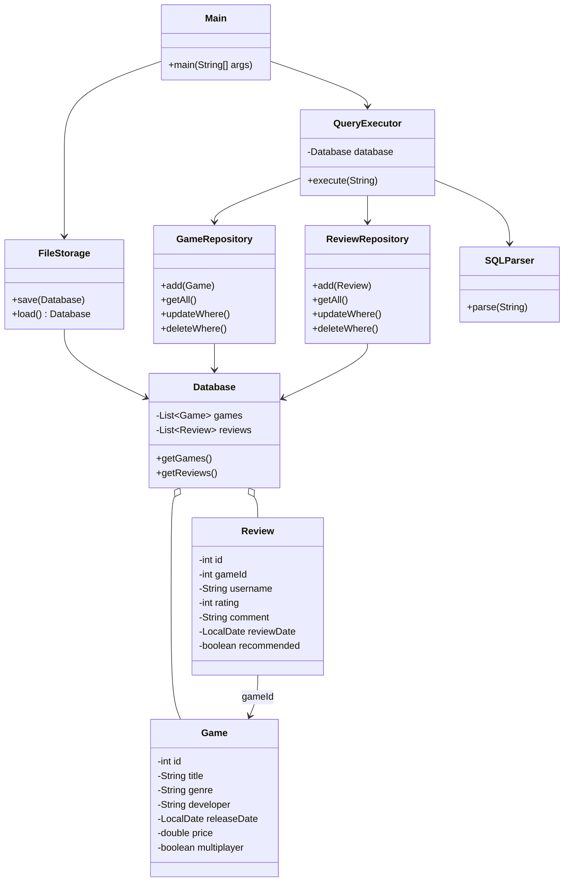
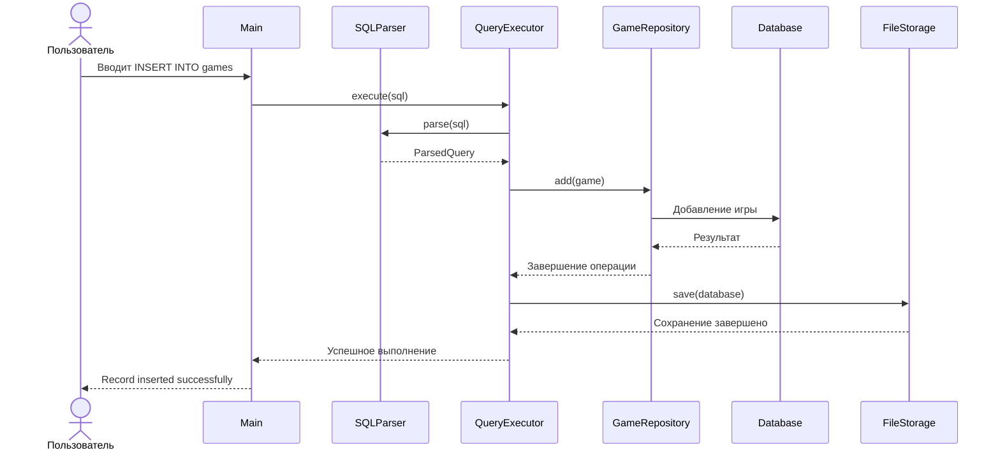

# GamesDBMS

## 1. Описание проекта

**GamesDBMS** — упрощённая система управления базами данных, разработанная на языке Java 17.0.12.

Предметная область проекта — видеоигры и пользовательские отзывы к ним.

Программа позволяет хранить информацию об играх и отзывах пользователей, добавлять новые записи, просматривать данные, изменять и удалять записи с помощью SQL-подобного языка запросов.

Данные сохраняются на диске с использованием механизма сериализации Java и загружаются при следующем запуске программы.

### Основные возможности
- Хранение информации в двух связанных таблицах: games и reviews.
- Добавление записей с проверкой уникальности первичного ключа.
- Просмотр всех записей или отдельных столбцов.
- Фильтрация записей с помощью условия WHERE.
- Обновление существующих записей.
- Удаление записей.
- Сохранение и загрузка базы данных из файла.
- Обработка некорректных запросов.

## 2. Архитектура системы

Проект построен с использованием объектно-ориентированного подхода. Для разделения ответственности используются отдельные классы моделей, репозиториев, хранения данных и обработки запросов.

## 2.1. Структура проекта

  

```text
GamesDBMS/
  │
  ├── src/
  │   ├── Main.java
  │   │
  │   ├── model/
  │   │   ├── Game.java
  │   │   └── Review.java
  │   │
  │   ├── storage/
  │   │   ├── Database.java
  │   │   └── FileStorage.java
  │   │
  │   ├── repository/
  │   │   ├── GameRepository.java
  │   │   └── ReviewRepository.java
  │   │
  │   └── query/
  │       ├── SQLParser.java
  │       └── QueryExecutor.java
  │
  ├── data/
  │   └── database.dat
  │
  └── README.md
```

## 2.2. Описание основных компонентов

|Компонент	|Назначение|
|:---------|:---------|
|Main	|Главный класс, обеспечивает взаимодействие с пользователем через консоль|
|Game	|Модель видеоигры|
|Review	|Модель пользовательского отзыва|
|Database	|Содержит коллекции игр и отзывов|
|FileStorage	|Отвечает за сериализацию, сохранение и загрузку базы данных|
|GameRepository	|Выполняет операции с таблицей игр|
|ReviewRepository	|Выполняет операции с таблицей отзывов|
|SQLParser	|Разбирает SQL-подобные запросы|
|QueryExecutor	|Выполняет разобранные запросы|

## 2.3. Диаграмма классов



## 2.4. Связь между таблицами

В системе предусмотрены две связанные таблицы.

### Таблица games:

| Поле	 | Тип данных| Описание |
|:---------|:---------|:---------|
| id	   | Integer	   |Первичный ключ|
| title	| String	|Название игры|
| genre	| String	|Жанр|
| developer	| String	|Разработчик|
| releaseDate	| Date	|Дата выхода|
| price	| Double	|Цена|
|multiplayer	|Boolean	|Поддержка многопользовательского режима|

### Таблица reviews:

|Поле	|Тип данных	|Описание|
|:---------|:---------|:---------|
|id	|Integer	|Первичный ключ|
|gameId	|Integer	|Внешний ключ|
|username	|String	|Имя пользователя|
|rating	|Integer	|Оценка игры|
|comment	|String	|Текст отзыва|
|reviewDate	|Date	|Дата отзыва|
|recommended	|Boolean	|Рекомендует ли пользователь игру|

Связь между таблицами реализована через поле gameId в таблице reviews, которое ссылается на поле id таблицы games.

Тип связи — один ко многим: одна игра может иметь несколько отзывов.

## 2.5. Диаграмма последовательности

Диаграмма показывает процесс выполнения SQL-запроса на добавление новой игры.



## 3 Обработка SQL-запросов

В системе реализована обработка основных SQL-команд:

- INSERT INTO — добавление записей.
- SELECT — получение записей.
- UPDATE — изменение записей.
- DELETE — удаление записей.

Поддерживается условие WHERE со следующими операторами сравнения:

$$=$$
$$!=$$
$$<>$$
$$>$$
$$<$$
$$>=$$
$$<=$$

Также реализован выбор отдельных столбцов.

## 4. Результаты тестирования производительности

В рамках данной лабораторной работы реализована базовая версия СУБД без использования индексов.

Поиск и фильтрация записей выполняются последовательным перебором элементов соответствующей коллекции.

Таким образом, сравнительное тестирование производительности с использованием индексов и без них не проводилось.

## 5. Инструкция пользователя

### 5.1. Запуск программы
Открыть проект в IntelliJ IDEA или другой среде разработки Java.
Убедиться, что используется JDK версии 8 или выше.
Открыть файл Main.java.
Запустить метод main().

После запуска программа загружает существующую базу данных из файла data/database.dat.

Если файл отсутствует, создаётся новая пустая база данных.

Для завершения работы программы необходимо ввести EXIT.

Перед завершением работы база данных сохраняется на диск.

### 5.2. Добавление игры

Для добавления новой игры используется команда:

```code
INSERT INTO games VALUES (
    1,
    'Minecraft',
    'Sandbox',
    'Mojang',
    '2011-11-18',
    29.99,
    TRUE
);
```

### 5.3. Добавление отзыва

```code
INSERT INTO reviews VALUES (
    1,
    1,
    'Alex',
    10,
    'Amazing game!',
    '2026-11-15',
    TRUE
);
```

В данном примере отзыв относится к игре с идентификатором 1.

### 5.4. Просмотр всех игр

```code
SELECT * FROM games;
```

### 5.5. Просмотр всех отзывов

```code
SELECT * FROM reviews;
```

### 5.6. Выбор отдельных столбцов

```code
SELECT title, price FROM games;
```

### 5.7. Использование условия WHERE

```code

SELECT * FROM games WHERE price > 20;
```

Данный запрос выводит игры, стоимость которых превышает 20.

### 5.8. Обновление записи

```code
UPDATE games SET price = 19.99 WHERE id = 1;
```

Запрос изменяет стоимость игры с идентификатором 1.

### 5.9. Удаление записи

```code
DELETE FROM reviews WHERE id = 1;
```

Запрос удаляет отзыв с идентификатором 1.

### 5.10. Сохранение данных

Все изменения сохраняются в файл data/database.dat.

При повторном запуске программы данные автоматически загружаются из файла.

## 6. Тестирование программы

В ходе проверки были выполнены следующие тесты:

|№	|Проверка	|Ожидаемый результат	|Результат|
|:---------|:---------|:---------|:---------|
|1	|Добавление игры	|Запись добавлена	|Успешно|
|2	|Добавление отзыва	|Запись добавлена	|Успешно|
|3	|Просмотр игр	|Вывод таблицы игр	|Успешно|
|4	|Просмотр отзывов	|Вывод таблицы отзывов	|Успешно|
|5	|Обновление цены игры	|Значение изменено	|Успешно|
|6	|Удаление отзыва	|Запись удалена	|Успешно|
|7	|Сохранение базы данных	|Данные записаны в файл	|Успешно|
|8	|Повторный запуск	|Данные восстановлены	|Успешно|
|9	|Обработка некорректных запросов	|Вывод сообщения об ошибке	|Успешно|

По результатам тестирования основные функции программы работают корректно.

## 7. Область ответственности участников

Проект выполнен индивидуально.

## 8. Выводы

В результате выполнения лабораторной работы была разработана упрощённая система управления базами данных GamesDBMS на языке Java.

В ходе работы были реализованы:

- Две связанные таблицы для хранения информации об играх и пользовательских отзывах.
- Механизм сериализации и сохранения данных в файлы.
- Загрузка базы данных при запуске программы.
- Проверка уникальности первичных ключей.
- Добавление, просмотр, обновление и удаление записей.
- Обработка SQL-подобных запросов.
- Консольный интерфейс для взаимодействия с пользователем.

При разработке использовались принципы объектно-ориентированного программирования и разделение ответственности между компонентами системы.

В результате была получена работающая упрощённая СУБД, позволяющая выполнять основные операции управления данными и сохранять результаты работы между запусками программы.

## 9. Использованные источники
- Oracle. Java Documentation. https://docs.oracle.com/en/java/
- Oracle. Java Object Serialization Specification. https://docs.oracle.com/javase/8/docs/platform/serialization/spec/serialTOC.html
- Oracle. Java Collections Framework. https://docs.oracle.com/javase/8/docs/technotes/guides/collections/
- Mermaid Documentation. Class Diagrams. https://mermaid.js.org/syntax/classDiagram.html
- Mermaid Documentation. Sequence Diagrams. https://mermaid.js.org/syntax/sequenceDiagram.html